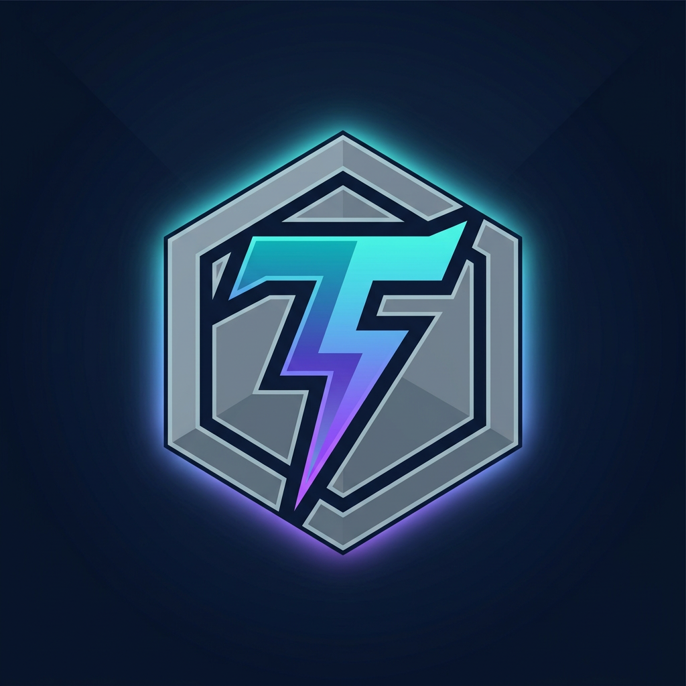

<div align="center">



# TiTaN Panel
### پنل مدیریت کانفیگ‌های VLESS، VMess و Trojan

</div>

TiTaN is a FastAPI control panel and Xray deployment packaged as one container. Nginx is the public HTTP front door; FastAPI, Xray and their control API bind to loopback. SQLite and generated transport paths are persisted under `/data`.

## پروتکل‌ها و انتقال‌ها

| پروتکل | انتقال‌های فعال |
|---|---|
| VLESS | WebSocket، XHTTP |
| VMess | WebSocket، XHTTP |
| Trojan | WebSocket |

فقط انتقال‌های جدول بالا پشتیبانی می‌شوند. مسیرهای WS و XHTTP به‌صورت تصادفی ساخته و در `/data/paths.json` نگه‌داری می‌شوند؛ بنابراین با restart یا deploy عادی لینک‌ها عوض نمی‌شوند.

پروتکل‌ها و انتقال‌های بازنشسته در دیتابیس قدیمی، از جمله HTTPUpgrade، gRPC و TCP خام، به VLESS+WS/TLS تبدیل می‌شوند. درخواست‌های API قدیمی برای گزینه‌های پشتیبانی‌نشده نیز به VLESS+WS/TLS نگاشت می‌شوند. پنل دیگر endpoint عمومی `/dns-query` ندارد.

## معماری اجرا

```text
Client ── HTTPS / public $PORT ──► Nginx
                                    ├── /login, /dashboard, /api, /sub ─► FastAPI 127.0.0.1:10000
                                    ├── generated WS / XHTTP routes ─► Xray on 127.0.0.1
                                    └── / ─► static landing page
```

Xray listener map (همه روی `127.0.0.1`):

| Listener | Port | مسیر عمومی Nginx |
|---|---:|---|
| VLESS WebSocket | 10001 | مسیر تصادفی زیر `/vl-ws/` |
| VMess WebSocket | 10002 | مسیر تصادفی زیر `/vm-ws/` |
| Trojan WebSocket | 10003 | مسیر تصادفی زیر `/tr-ws/` |
| VLESS XHTTP | 10004 | مسیر تصادفی زیر `/xhttp/` |
| VMess XHTTP | 10005 | مسیر تصادفی زیر `/xhttp/vmess/` |
| Xray API | 10085 | عمومی نیست |

پورت‌های listener را می‌توان با متغیرهای `XRAY_*_PORT` تغییر داد. مسیرهای تصادفی WS و XHTTP به‌صورت پایدار در `/data/paths.json` نگه‌داری می‌شوند. Nginx برای API و subscription rate limit دارد. `watchdog.py` هر ۵ ثانیه سلامت Nginx، پنل و Xray را بررسی می‌کند و رویدادها را در `/data/watchdog.log` می‌نویسد.

## شروع سریع

### Railway یا محیط Docker مشابه

1. Repository را از GitHub deploy کنید؛ build از `Dockerfile` انجام می‌شود.
2. از تنظیمات سرویس Railway یک Railway Volume بسازید و mount path دقیق را `/data` بگذارید. دستور `VOLUME` عمداً در Dockerfile نیست؛ storage را خود Railway مدیریت می‌کند.
3. متغیر `PORT` را به پلتفرم بسپارید. در صورت نیاز `TITAN_ADMIN_USER` و `TITAN_ADMIN_PASS` را پیش از اولین اجرا تنظیم کنید.
4. به `/login` بروید و پس از ورود، رمز پیش‌فرض را تغییر دهید.

بدون volume در `/data`، دیتابیس، بکاپ و random paths بعد از تعویض container پایدار نمی‌مانند. برای local Docker، نمونه در [DEPLOY.md](DEPLOY.md) است.

### اجرای توسعه محلی

```bash
python -m venv .venv
. .venv/bin/activate
pip install -r requirements.txt
TITAN_DATA_DIR="$PWD/data" PANEL_HOST=127.0.0.1 PANEL_PORT=10000 \
  uvicorn app.main:app --host 127.0.0.1 --port 10000
```

در اجرای مستقیم، FastAPI در حالت توسعه Xray را خودش مدیریت می‌کند؛ در کانتینر، supervisor بیرونی Xray را اجرا می‌کند تا دو مدیر هم‌زمان نداشته باشیم.

## تنظیمات محیطی

| Variable | Default | Purpose |
|---|---|---|
| `PORT` | `8080` | پورت عمومی Nginx که پلتفرم می‌تواند override کند |
| `PANEL_HOST` | `127.0.0.1` | bind پنل |
| `PANEL_PORT` | `10000` | پورت داخلی FastAPI |
| `TITAN_DATA_DIR` | `/data` | دیتابیس، بکاپ، paths و لاگ‌ها |
| `TITAN_ADMIN_USER` | `TiTaN` | نام ادمین اولیه |
| `TITAN_ADMIN_PASS` | `TiTaN` | رمز ادمین اولیه؛ حتماً پس از نصب عوض شود |
| `TITAN_NODE_SECRET` | — | secret اختیاری برای همگام‌سازی چندنودی |

## مسیرهای مهم

- `/` — صفحه فرود
- `/login`, `/dashboard` — پنل مدیریت
- `/api/users`, `/api/nodes`, `/api/settings` — API مدیریتی
- `/sub/<uid>` — subscription عمومی
- `/status/<uid>` و `/api/status/<uid>` — وضعیت عمومی کاربر
- `/healthz` — liveness و healthcheck کانتینر
- `/health` — بررسی node-to-node

برای ریزتنظیم پورت‌ها، volume، healthcheck و اجرای Docker به [DEPLOY.md](DEPLOY.md) مراجعه کنید.

---

## English

The complete inventory of removed/replaced lines, with original line numbers from the Git baseline, is in [`DELETED_LINES.jsonl`](DELETED_LINES.jsonl).

TiTaN is a single-container FastAPI control panel with Nginx and Xray. Supported combinations are **VLESS WS/XHTTP**, **VMess WS/XHTTP**, and **Trojan WS**. Public traffic enters through Nginx on `$PORT`; FastAPI and every Xray listener are loopback-only. Random transport paths persist in `/data/paths.json`, and the watchdog logs to `/data/watchdog.log` every five seconds.

Deploy the repository using its Dockerfile, then open `/login`. On Railway, add a Railway Volume in the service settings and mount it at `/data`; the Dockerfile intentionally omits Docker's `VOLUME` instruction because Railway manages persistent storage itself. Retired protocol and transport selections are migrated to VLESS+WS/TLS. The public DoH endpoint and retired proxy protocols are not part of this build.
